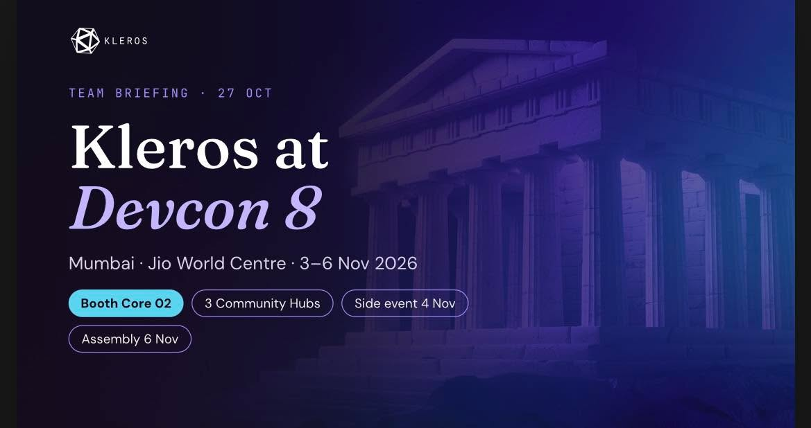
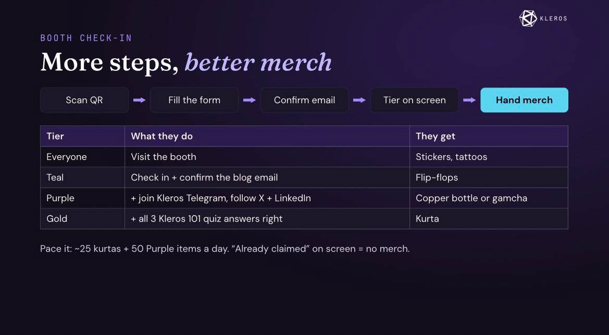

# Kleros reference palette

The human supplied two images on 29 October 2026 and requested their color schemes for the app.
Their slide copy and booth workflow are reference content, not additional product requirements.
Colors below are practical samples from raster images, rather than a claim of official brand hex values.

| Role | CSS token | Color |
| --- | --- | --- |
| Canvas | `--paper` | `#120E1C` |
| Rail / dark action labels | `--deep`, `--on-accent` | `#100C19` |
| Cards / inputs | `--surface` | `#1C1829` |
| Raised plum surfaces | `--raised` | `#2E1D4C` |
| Body / heading | `--ink`, `--heading` | `#EEEAF5`, `#FCFAFF` |
| Supporting text | `--muted` | `#CAC5D5` |
| Links / focus / selection | `--purple` | `#C2B5F2` |
| Primary action / loading | `--teal` | `#5BD4EF` |
| Primary hover | `--teal-hover` | `#86E2F5` |
| Decorative / interactive boundary | `--line`, `--boundary` | `#473C5F`, `#84739E` |

Use cyan primary buttons with dark labels, lavender links/focus/navigation, near-black plum canvas
and soft white text. Keep gradients restrained behind content; cards and controls use solid surfaces.
Use the brighter control boundary for inputs and secondary buttons. Decorative separators are
deliberately quieter. Existing success, warning and error colors retain their semantic meaning.
Status still requires text, not color alone.

Independent sRGB contrast review found at least 8.01:1 for body/supporting/lavender text across the
canvas, card and raised surfaces. Dark text on cyan is 11.12:1 (13.05:1 on hover); control boundaries
remain at least 3.53:1 across these surfaces. These checks cover the palette, not a full accessibility
certification. Desktop/mobile browser verification is recorded in [TEST_REPORT](TEST_REPORT.md).

Applied in root `public/styles.css` and `public/index.html`; loading and supplementary UI styles inherit
the shared tokens. Also applied to the active compact-portal UI worktree's shared CSS/HTML and
`public/luma-launch.css` after the human explicitly added the deposit page. Its launch accent now
inherits cyan; the old teal overrides of lavender links/focus and dark action labels are removed.
Preserve these changes during integration. The original redesign handoff, retained legacy
apps and separately owned wallet deployment review tool are outside this palette patch.
This is a local UI change; production publication remains with the release owner.

